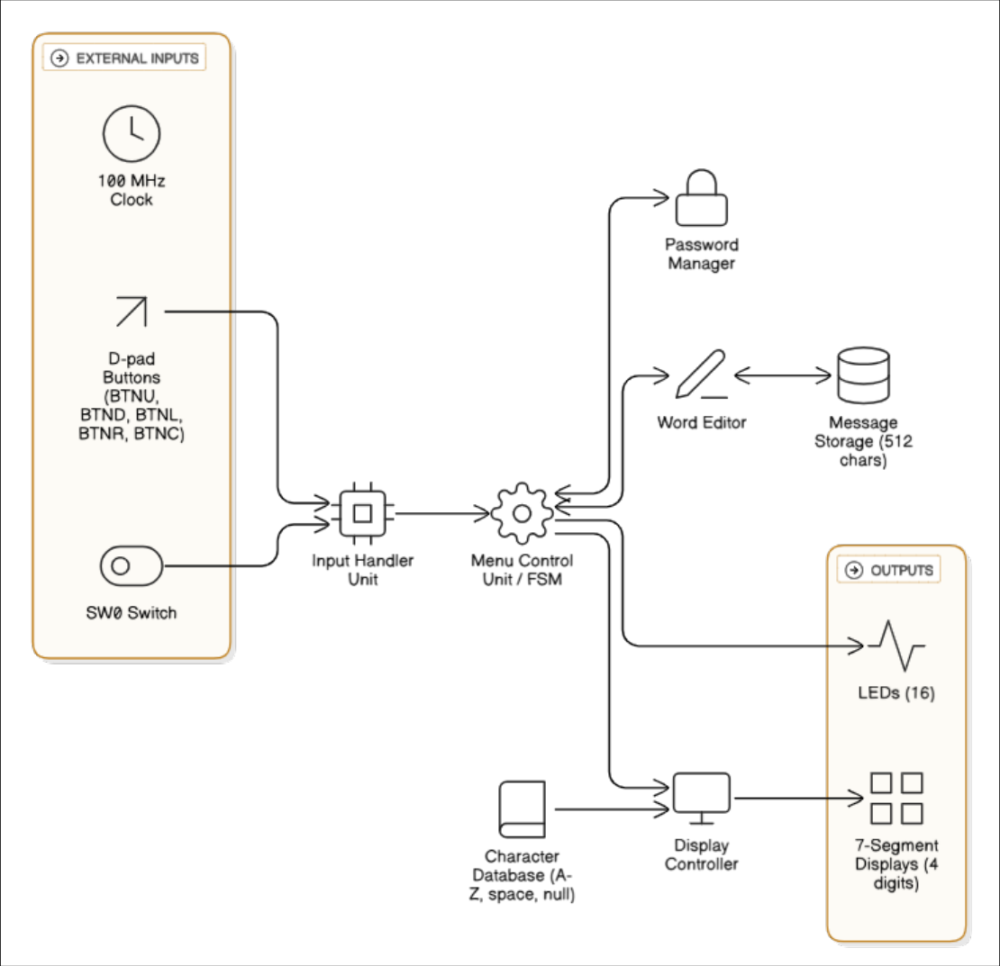
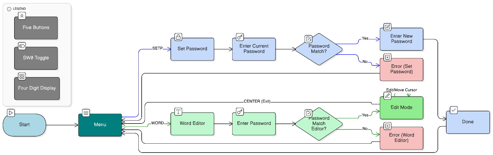

# Verilock

## A Password-Protected Word Display System

Verilock is a hardware-only word editor for the **Digilent Basys3 FPGA board**. A six-direction button pattern protects both the message editor and the password-change workflow. Once authenticated, the user can edit a 512-character message through the board's directional buttons and view it through a scrolling four-digit seven-segment window.

The project brings together finite state machines, sequential logic, compact data encoding, bounded memory search, and multiplexed display control in a single Verilog design. No processor, operating system, keyboard, or external display is required.

**Academic project:** CSE 1204 — Digital Logic Design Laboratory, Department of Computer Science and Engineering, Khulna University of Engineering & Technology (KUET).

| At a glance | Implementation |
| --- | --- |
| Platform | Digilent Basys3; Artix-7 XC7A35T-1CPG236C |
| HDL / top-level module | Verilog / `verilock` |
| System clock | 100 MHz; 10 ns clock constraint |
| Authentication | Six directional presses; four possible directions per press |
| Default password | `UP → UP → UP → UP → UP → UP` |
| Message capacity | 512 entries × 5 bits = 2,560 logical storage bits |
| Editable characters | A–Z, SPACE, and NULL |
| User interface | Five push buttons, SW0, four seven-segment digits, LED0 |
| Navigation | Skip NULL entries, or visit every position in a circular buffer |
| Persistence | Message and changed password are volatile |

> This README describes the checked-in RTL and constraints. The original reports explain the project background and intended design; where a report or source comment differs from executable logic, the implementation takes precedence. Verilock is an educational access-control prototype, not a production security system.

## Contents

- [Quick start: first message](#quick-start-first-message)
- [Project files and original reports](#project-files-and-original-reports)
- [Controls and display](#controls-and-display)
- [Changing the password](#changing-the-password)
- [Message editing and navigation](#message-editing-and-navigation)
- [Architecture and state machine](#architecture-and-state-machine)
- [Storage, encoding, and timing](#storage-encoding-and-timing)
- [Hardware and pin assignments](#hardware-and-pin-assignments)
- [Build and program the FPGA](#build-and-program-the-fpga)
- [Verification and testing](#verification-and-testing)
- [Troubleshooting](#troubleshooting)
- [Limitations and future work](#limitations-and-future-work)
- [Team and academic context](#team-and-academic-context)

## Quick start: first message

After building and programming the design:

1. Set **SW0 = 1**. LED0 turns on. This mode lets you move into empty message positions.
2. The initial menu selection is **SETP**. Press **DOWN once** to select **WORD**, then press **CENTER**.
3. Enter the default password: press and release **UP six times**. The sixth direction automatically completes authentication; do not press CENTER to submit it.
4. The editor opens at message position 0. Its four-digit view is initially blank because all message entries start as NULL.
5. Press **UP once** to put `A` at position 0. Press **RIGHT once**, then **UP twice**, to put `B` at position 1. The message now begins with `AB`.
6. Press **CENTER** to return to the menu. Re-entering WORD requires authentication again, but the message remains in memory until the FPGA is reconfigured or loses power.

Use individual press-and-release actions and operate one button at a time. Holding a button is not an auto-repeat operation, and physical button bounce is not filtered by this RTL. Simultaneous presses are not a supported chord interface: authentication applies a fixed priority, while the editor can process multiple actions on the same clock.

## Project files and original reports

```text
Verilock/
├── README.md
├── verilock.v
├── verilock.xdc
└── docs/
    ├── assets/
    │   ├── system-architecture.png
    │   └── system-flow.png
    └── reference/
        ├── VERILOCK A PASSWORD-PROTECTED WORD DISPLAY SYSTEM.PDF
        ├── VERILOCK REPORT.PDF
        └── VERILOCK_LAB_REPORT.PDF
```

| File | Purpose |
| --- | --- |
| [`verilock.v`](verilock.v) | Complete design: input edge detection, authentication, FSM, message editing, search, character lookup, and display multiplexing |
| [`verilock.xdc`](verilock.xdc) | Basys3 pin assignments, LVCMOS33 I/O standards, 100 MHz clock constraint, and configuration voltage properties |
| [Final course report](docs/reference/VERILOCK%20REPORT.PDF) | Original course submission, academic attribution, architecture diagram, design discussion, and reported testing |
| [Alternate lab report](docs/reference/VERILOCK_LAB_REPORT.PDF) | Additional project description, state definitions, timing discussion, and pin-assignment appendix |
| [Original system flow diagram](docs/reference/VERILOCK%20A%20PASSWORD-PROTECTED%20WORD%20DISPLAY%20SYSTEM.PDF) | One-page overview of password management and editor access |

The PDFs are archived unchanged. The images in `docs/assets/` are taken from those original documents. The final course report is the reference for the team and academic context; the alternate report is retained as a historical document rather than treated as a replacement for the RTL.

## Controls and display

### Button behavior

| Context | UP / DOWN | LEFT / RIGHT | CENTER |
| --- | --- | --- | --- |
| Main menu | Either button toggles between SETP and WORD | No action | Open the selected authentication workflow |
| Current-password entry | Enter the corresponding direction | Enter the corresponding direction | Incomplete entry becomes an error |
| New-password entry | Enter the corresponding direction | Enter the corresponding direction | Incomplete entry becomes an error; old password is retained |
| Word editor | Cycle the current character forward / backward | Move the cursor according to SW0 | Exit to the menu |
| DONE / error display | No user action is processed | No user action is processed | Wait for the timed return to the menu |

The two password-entry workflows automatically accept the sixth direction. CENTER is neither a password terminator nor a save button in those states.

### Display messages

| Display | Meaning |
| --- | --- |
| `SETP` | Password-change menu option |
| `WORD` | Message-editor menu option |
| `AUTn` | Current-password entry; `n` is the entered-direction count |
| `NEWn` | New-password entry; `n` is the entered-direction count |
| `DONE` | New password has been stored |
| `ERRR` | Authentication failed or CENTER was pressed during incomplete password entry |
| Four message characters | Current message viewport; the cursor's digit blinks |

`AUTn` is the actual four-digit layout: `A`, `U`, `T`, then a numeric counter. References in the reports to a literal `AUTH` display are a conceptual description, not the exact implemented display. Seven-segment letter shapes are approximations, so some letters resemble lowercase forms.

### Switch and LEDs

- **SW0 = 0:** looping navigation; LEFT and RIGHT search for non-NULL entries.
- **SW0 = 1:** full-buffer navigation, called “infinite mode” in the source and reports; LEFT and RIGHT visit adjacent positions, including NULL entries.
- **LED0:** directly mirrors SW0.
- **LED1–LED15:** held off in this implementation.

“Infinite” describes continuous circular navigation, not unlimited memory.

## Changing the password

1. Select **SETP** in the menu and press CENTER.
2. Enter the current six-direction pattern. The default is six UP presses.
3. After successful authentication, the display changes to `NEWn`.
4. Enter exactly six directions for the new password. For example:

   ```text
   UP → DOWN → LEFT → RIGHT → UP → DOWN
   ```

5. The sixth direction immediately replaces the stored password. There is no second confirmation entry.
6. `DONE` appears for approximately one second, then the system returns to the menu.

The same stored password protects both SETP and WORD. A wrong current password displays `ERRR` for approximately one second and returns to the menu; it does not grant access or change the stored password.

Changed passwords survive menu transitions, not power loss or FPGA reconfiguration. There is no separate reset input, persistent password store, attempt counter, or lockout policy.

## Message editing and navigation

### Character editing

Each memory position holds one character code. UP and DOWN change that position in place; they do not insert a new position or shift the rest of the message.

```text
UP:    NULL → A → B → ... → Z → SPACE → NULL
DOWN:  NULL → SPACE → Z → ... → B → A → NULL
```

- **SPACE** is a real, non-NULL entry. Its letter segments are off, but its decimal point is on.
- **NULL** is an empty entry: all segments and the decimal point are off. Looping navigation skips it.
- To delete a character, cycle its position to NULL.
- Digits and punctuation are not editable message characters. The numeric lookup is used only for the password-entry counter.

### Full-buffer mode: SW0 = 1

LEFT and RIGHT move by one position, whether that position contains a letter, SPACE, or NULL:

```text
0 ↔ 1 ↔ 2 ↔ ... ↔ 510 ↔ 511 ↔ 0
```

This is the appropriate mode for composing a message in an initially empty buffer or editing sparse positions.

### Looping mode: SW0 = 0

LEFT and RIGHT start a sequential search in the requested direction. The search skips NULL entries and wraps around the 512-position buffer. SPACE counts as populated and can be a search destination.

A search is bounded: the FSM stops after a full-buffer scan rather than hanging if every entry is NULL. In the all-NULL case, the current implementation eventually selects the initially requested adjacent position. If only one entry is populated, navigation can wrap back to that same entry.

### Four-character viewport

The display shows `message[viewport_start]` through `message[viewport_start + 3]`, left to right. The viewport shifts when the cursor leaves that window:

- Moving left of the window makes the cursor its leftmost character.
- Moving past the window's right edge shifts the window so the cursor remains visible at the right.
- Cursor movement wraps at positions 0 and 511.
- Re-entering WORD starts the cursor and viewport at position 0; it does not restore the last editing position.

This is cursor-driven window movement, not an automatic scrolling-text animation.

## Architecture and state machine

### Functional architecture



*Functional architecture from the final course report. The blocks describe responsibilities; the repository implements them inside one top-level Verilog module, not six separately instantiated source modules.*

The implementation has these main responsibilities:

1. **Input edge detection:** compares each raw button input with its previous sampled value.
2. **Password handling:** packs six directions into a 12-bit pattern and compares entered patterns with the stored password.
3. **Menu and access control:** selects SETP or WORD and routes successful or failed authentication.
4. **Word editing:** updates message entries, tracks the cursor, and manages the viewport.
5. **Bounded search:** visits memory locations one clock at a time when looping navigation is selected.
6. **Display control:** converts character codes to active-low segment patterns, multiplexes the four digits, and blanks the cursor digit during one blink phase.

The FSM and display-output logic use the same 100 MHz `clk`. The refresh and blink counters provide enables or selection signals; they do not introduce separate generated-clock domains. External buttons and SW0 are nevertheless asynchronous inputs and are not passed through a dedicated two-flop synchronizer.

### State definitions

| State | Encoding | Role and main transitions |
| --- | --- | --- |
| `STATE_MENU` | `000` | Show SETP or WORD; CENTER selects its authentication state |
| `STATE_SETP_AUTH` | `001` | Verify the current password before changing it; match → SETP_NEW, failure → ERROR |
| `STATE_SETP_NEW` | `010` | Collect six new directions; sixth direction stores the password → SETP_DONE |
| `STATE_SETP_DONE` | `011` | Show DONE temporarily → MENU |
| `STATE_WORD_AUTH` | `100` | Verify the password for editing; match → WORD_EDIT, failure → ERROR |
| `STATE_WORD_EDIT` | `101` | Edit characters and move the cursor; looping movement → SEARCHING, CENTER → MENU |
| `STATE_ERROR` | `110` | Show ERRR temporarily → MENU |
| `STATE_SEARCHING` | `111` | Find the next non-NULL position or exhaust the bounded scan → WORD_EDIT |

Pressing CENTER during an incomplete authentication or new-password entry also enters ERROR. Password-entry counts and temporary input buffers are reset as the workflows restart.

### Project flow



*Original project flowchart. The control tables above supply implementation details omitted from the figure, including menu selection and automatic submission of the sixth direction.*

## Storage, encoding, and timing

### Password encoding

| Direction | Stored two-bit value |
| --- | --- |
| UP | `00` |
| DOWN | `01` |
| LEFT | `10` |
| RIGHT | `11` |

The first direction occupies bits `[11:10]`; the sixth occupies `[1:0]`. The fixed six-direction format represents `4^6 = 4,096` possible patterns, or 12 bits of pattern space. It is a direct pattern comparison, not encryption or cryptographic password hashing.

### Message representation

| Value | Meaning |
| --- | --- |
| `0`–`25` | A–Z |
| `26` | SPACE; decimal-point marker |
| `27` | NULL; empty entry skipped by looping search |
| `28` | Internal display placeholder used for the password counter, not an editable message character |

The declaration `reg [4:0] message [0:511]` defines 2,560 logical storage bits, equivalent to 320 packed bytes. This is not a measured FPGA resource-utilization result. Whether synthesis implements the array using registers, distributed RAM, or block RAM must be checked in the actual Vivado synthesis report; array size alone does not establish block-RAM inference.

All message entries are initialized to NULL in an `initial` loop. Register declaration initializers establish the startup state, default password, counters, and cursor values. This initialization strategy targets FPGA configuration behavior rather than a runtime reset protocol.

### Timing at 100 MHz

| Function | RTL basis | Result |
| --- | --- | --- |
| System clock | XDC clock period `10.00 ns` | 100 MHz |
| Next active digit | `refresh_counter == 65000`, then reset to zero | One digit step per 65,001 clocks, approximately 650.01 µs |
| Full four-digit scan | Four digit steps | Approximately 2.60004 ms, or 384.61 Hz per digit |
| Cursor blink | Bit 24 of a 25-bit free-running counter | Approximately 2.98 complete on/off cycles per second; 167.77 ms per half-cycle |
| DONE / error hold | Timer loaded with `100000000` | Approximately one second, with clock-level transition overhead |
| All-NULL search | At most 513 search-state evaluations | Approximately 5.13 µs of search-state time, excluding button/entry overhead |

The source comment and reports describe the blink as approximately 1.5 Hz. The actual `blink_counter[24]` implementation at 100 MHz produces approximately **2.98 Hz**. The table follows the executable counter logic.

### Display update details

Display values pass through registered stages: `display_chars` feeds `current_seg_data`, which then feeds `seg` and `dp`. The digit-enable output `an` does not share that final data stage, so a scan change has a one-system-clock offset between the new digit selection and its segment data. There is no explicit interdigit blanking interval. This is an RTL timing observation, not a measured claim of visible ghosting; inspect the physical display when validating or revising the scan controller.

## Hardware and pin assignments

### Required hardware

- Digilent Basys3 development board with Artix-7 XC7A35T-1CPG236C FPGA.
- USB programming connection and board power.
- AMD/Xilinx Vivado with the Artix-7 device support needed for this part.

All interaction uses on-board peripherals. This design does not require a keypad, external display, serial terminal, or additional message memory.

### Inputs

| RTL signal | FPGA package pin | Function |
| --- | --- | --- |
| `clk` | W5 | 100 MHz clock |
| `BTNU` | T18 | UP button |
| `BTND` | U17 | DOWN button |
| `BTNL` | W19 | LEFT button |
| `BTNR` | T17 | RIGHT button |
| `BTNC` | U18 | CENTER button |
| `SW0` | V17 | Navigation mode |

### Seven-segment display

Segment cathodes, decimal point, and digit enables are active-low. These are the actual assignments in this project's XDC:

| RTL signal | Package pin | Physical display line |
| --- | --- | --- |
| `seg[6]` | W7 | CA / segment A |
| `seg[5]` | W6 | CB / segment B |
| `seg[4]` | U8 | CC / segment C |
| `seg[3]` | V8 | CD / segment D |
| `seg[2]` | U5 | CE / segment E |
| `seg[1]` | V5 | CF / segment F |
| `seg[0]` | U7 | CG / segment G |
| `dp` | V7 | Decimal point |
| `an[0]` | U2 | Rightmost digit |
| `an[1]` | U4 | Second digit from the right |
| `an[2]` | V4 | Third digit from the right |
| `an[3]` | W4 | Leftmost digit |

In this repository, `seg[6:0]` maps to physical segments A through G in that order. The RTL's declaration comment describes the opposite ordering, while the actual lookup values and XDC use the table above. Digilent's generic master XDC uses the opposite segment bus indexing, so do not replace this project's segment assignments without adapting the decoder too.

### LEDs

| Signal | Pin | Signal | Pin |
| --- | --- | --- | --- |
| `led[0]` | U16 | `led[8]` | V13 |
| `led[1]` | E19 | `led[9]` | V3 |
| `led[2]` | U19 | `led[10]` | W3 |
| `led[3]` | V19 | `led[11]` | U3 |
| `led[4]` | W18 | `led[12]` | P3 |
| `led[5]` | U15 | `led[13]` | N3 |
| `led[6]` | U14 | `led[14]` | P1 |
| `led[7]` | V14 | `led[15]` | L1 |

All constrained I/O uses `LVCMOS33`. The XDC also sets `CONFIG_VOLTAGE` to `3.3` and `CFGBVS` to `VCCO`. Use the supplied [`verilock.xdc`](verilock.xdc) as the pin-assignment source of truth.

The board-pin cross-check used [Digilent's official Basys3 master XDC](https://github.com/Digilent/digilent-xdc/blob/master/Basys-3-Master.xdc), with the segment-index difference described above accounted for.

## Build and program the FPGA

### 1. Get the sources

```bash
git clone https://github.com/STARFALL088/Verilock.git
cd Verilock
```

Access to the repository is required if it is private. Only the two implementation files are needed for a Vivado build; the PDF reports and README images are documentation.

### 2. Create the Vivado project

1. Create an **RTL Project**.
2. Select the Basys3 board definition if installed, or select part **`xc7a35tcpg236-1`** directly.
3. Add `verilock.v` as a **design source**.
4. Add `verilock.xdc` as a **constraints source**.
5. Set **`verilock`** as the top-level module.
6. Check that the 10 ns clock and all top-level ports are recognized.

No generated Vivado project, IP block design, or prebuilt bitstream is included in this repository.

### 3. Synthesize, implement, and program

1. Run **Synthesis**. Review warnings and inspect how the message array is implemented.
2. Run **Implementation**. Inspect timing and design-rule reports; the clock constraint is a target, not evidence that timing closes.
3. Generate the **Bitstream**.
4. Connect and power the Basys3, then open **Hardware Manager**.
5. Open the hardware target, select the device, and program it with the generated `verilock.bit` file.
6. Follow [Quick start: first message](#quick-start-first-message).

These are the hardware build steps, not a claim that Vivado synthesis or board programming was rerun for this documentation update.

### Optional: Verilog syntax and elaboration check

With Icarus Verilog installed, run from the repository root:

```bash
mkdir -p build/sim
iverilog -g2005 -Wall -s verilock -o build/sim/verilock.vvp verilock.v
```

The checked-in RTL was successfully parsed and elaborated with **Icarus Verilog 13.0**. With `-Wall`, Icarus reports that the character-editing `@*` block is sensitive to all 512 message entries. These array-sensitivity diagnostics are warnings, not compile errors.

This command does not simulate button interactions or validate FPGA timing. There is no bundled self-checking testbench; running the design without stimulus is not a functional test.

## Verification and testing

### What was checked for this README

| Check | Result and scope |
| --- | --- |
| RTL parse and elaboration | Passed with Icarus Verilog 13.0 in Verilog-2005 mode; eight full-array `@*` sensitivity warnings |
| Functional RTL checks | A temporary white-box testbench completed **115 assertions with 0 failures** |
| Functional scenarios exercised | Startup, menu selection, default and changed passwords, premature CENTER errors, character cycling, held-button behavior, both navigation modes, sparse and all-NULL searches, endpoint wrap, viewport movement, message retention, LED0, and selected lookup values |
| Pin-assignment review | 35 port bits constrained to 35 distinct package pins; mapping checked against Digilent's Basys3 master XDC with this project's reversed segment-bus indexing accounted for |
| Original source preservation | `verilock.v` and `verilock.xdc` retained unchanged |
| Vivado synthesis / implementation | Not rerun for this update |
| Physical FPGA verification | Not performed for this update |

The temporary testbench accelerated the one-second timers and seeded an empty buffer for a bounded-search case. Those white-box checks establish the exercised digital behavior, not real-time button debouncing, metastability behavior, analog display quality, FPGA resource use, or timing closure. The testbench is not included in the project files above.

The original reports describe historical synthesis and hardware testing. No synthesis utilization report, timing report, or bitstream is archived here to independently substantiate their resource or timing claims. In particular, the reported LUT percentage and block-RAM usage should not be treated as measured results for a fresh build.

### Suggested board-validation checklist

- [ ] Authenticate with six UP presses in both SETP and WORD after fresh configuration.
- [ ] Confirm the sixth direction submits automatically, with no CENTER press.
- [ ] Change the password; verify the old pattern fails and the new pattern works in both workflows.
- [ ] Confirm wrong passwords and premature CENTER presses show ERRR and return to the menu.
- [ ] Cycle through A–Z, SPACE, and NULL in both directions.
- [ ] Confirm that SPACE shows a dot and remains a looping-search destination, while NULL is skipped.
- [ ] Enter a message longer than four characters and inspect viewport movement.
- [ ] Exercise positions 0 and 511, both wrap directions, sparse messages, and an all-NULL buffer.
- [ ] Toggle SW0 and verify LED0 and cursor-navigation behavior.
- [ ] Inspect segment glyphs, refresh stability, and cursor blink on the actual display.
- [ ] Reconfigure or power-cycle and confirm that the default password and empty buffer return.

## Troubleshooting

| Symptom | Check |
| --- | --- |
| Six UP presses do not authenticate | Ensure the design was freshly configured or use the changed password. Make distinct press-and-release actions; extra edges from bounce can alter the pattern. |
| CENTER produces ERRR during password entry | This is expected: password entry is submitted by the sixth direction, not CENTER. |
| The editor looks blank | The buffer starts as NULL. Press UP to create A; use SW0 = 1 to reach additional empty positions. |
| Looping movement does not advance one position | SW0 = 0 skips NULL entries. Switch to SW0 = 1 for adjacent-cell editing. |
| A blank-looking position is not skipped | It may be SPACE rather than NULL. SPACE has a decimal-point marker and is treated as populated. |
| Letters or menu text look distorted | Use the supplied segment pin mapping with this decoder. Generic master-XDC segment indexing differs, and seven-segment alphabet glyphs are necessarily approximate. |
| Password or message vanished | Both are volatile and initialized again after reconfiguration or power loss. CENTER is not a persistent save operation. |
| Unpredictable multiple actions from one physical press | This version uses edge detection without debouncing or input synchronizers. Reliable physical input conditioning is a known improvement area. |
| Vivado reports unexpected memory or resource use | Inspect the synthesized memory implementation and utilization report rather than relying on the report's approximate figures. |

## Limitations and future work

### Current limits

- **Input conditioning:** the RTL detects raw button edges but has no debounce filter, dedicated two-flop synchronizer, or held-button repeat generator. A single internal clock domain does not make external inputs synchronous.
- **Volatile state:** there is no nonvolatile password/message storage and no runtime reset port.
- **Small authentication space:** six directions provide 4,096 patterns. There is no lockout, attempt limiting, encryption, or protection against physical access to the FPGA implementation.
- **Display constraints:** four digits show only a window into the message; alphabet glyphs are approximations. Cursor blink, segment multiplexing, and glyph quality still need inspection on hardware.
- **Fixed editing model:** 512 fixed positions, no insertion/shift operation, no editable numbers or punctuation, and no automatic scrolling mode.
- **Unarchived build evidence:** the repository does not contain reproducible Vivado resource/timing reports or a prebuilt hardware image.

### Possible extensions — not implemented

1. Add synchronized and debounced physical inputs before edge detection.
2. Add an explicit reset/recovery policy and, if required, nonvolatile storage.
3. Add authentication attempt limiting and clearer feedback for incomplete entries.
4. Extend the character set or move to a display better suited to text.
5. Add automatic scrolling, multiple message banks, and optional button auto-repeat.
6. Add a version-controlled self-checking testbench, repeatable Vivado build scripts, and archived synthesis/timing results.

## Team and academic context

| Contributor | Student ID |
| --- | --- |
| Md. Minhaz Rahman | 2307005 |
| Sanjidur Rahman Prantor | 2307006 |

- **Institution:** Khulna University of Engineering & Technology (KUET).
- **Department:** Computer Science and Engineering.
- **Course:** CSE 1204 — Digital Logic Design Laboratory.
- **Academic stage recorded in the final report:** 1st Year, 2nd Term; Group A1.
- **Submitted to:** Dr. Al-Mahmud, Associate Professor, and Nabil Faiyaz Sadi, Lecturer, Department of CSE, KUET.

The final course report, alternate lab report, and original flow diagram are linked in [Project files and original reports](#project-files-and-original-reports). Their original authorship is retained. This documentation update does not modify the original Verilog, XDC, or PDFs.

## License

No license file is currently included in this repository.
